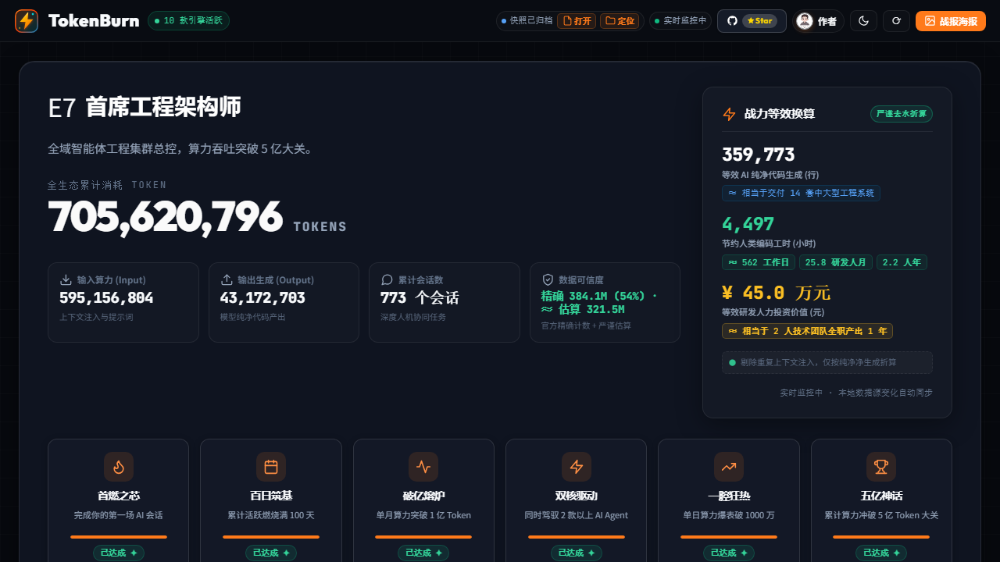
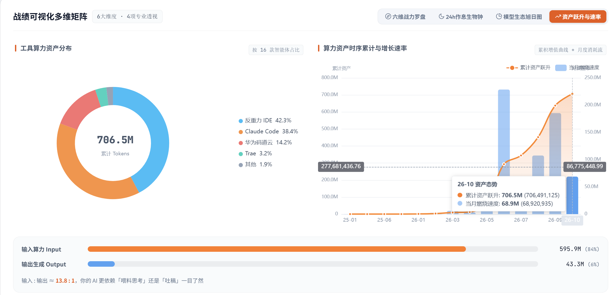
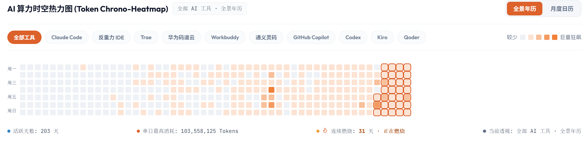
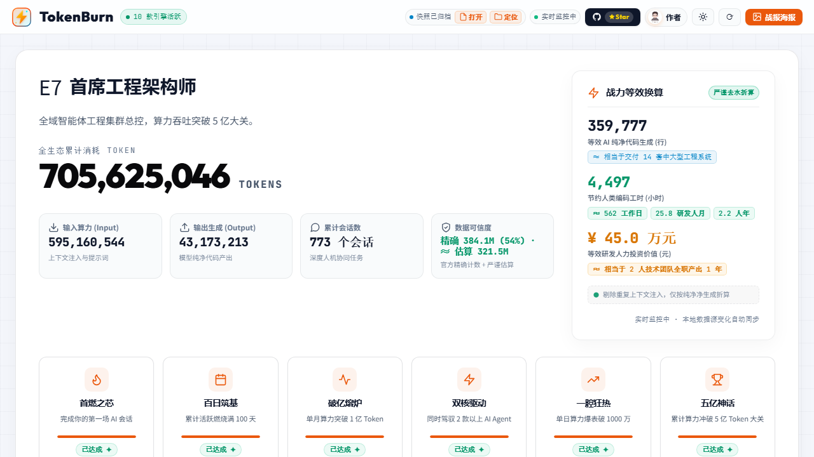

# 我查了下自己用 AI 写代码的数据，被这串数字震住了

前几天深夜改完最后一个接口，我习惯性地扫了一眼终端。

这大半年写代码的习惯彻底变了。
以前是自己逐行敲键盘查文档，现在全天候带着 AI 助手在终端和编辑器里并肩协作。

那天晚上我突然冒出一个念头：
跟着不同的 AI 工具日夜赶工，到底消耗了多少算力？又敲出了多少真实代码？

好奇心驱使下，我顺着几个软件的本地目录挨个扒拉。

翻出来的记录让我整个人愣在屏幕前：
本地沉淀的会话不知不觉积累了 700 多场，总算力消耗赫然突破了 7 亿大关。

看着散落各处的数据，程序员的强迫症瞬间上来了。
既然市面上没有现成工具能把这些记录一网打尽，不如干脆自己手搓一个。

于是，**TokenBurn** 诞生了。

*(TokenBurn 赛博极客看板，双击即开)*

---

### 1. 散落各处的痕迹，一秒聚齐

平时开发用过的工具有点杂。
终端里跑着 Claude Code，主力编辑器用着反重力，偶尔还要切到 Trae 或华为码道改特定工程。

这些记录藏得极深，有的埋在隐藏目录，有的锁在本地数据库里。

TokenBurn 做的第一件事就是全自动寻路，无需手动输入任何密钥，也无需配置路径。
运行脚本后，底层引擎十几秒内顺着硬盘静默扫描，装过的 16 款主流工具全部识别建档。

看着柱状图和热力图在看板上一格格点亮，就像在看自己这半年敲代码的打卡足迹。

*(工具算力分布环形图与时序累计趋势)*

*(200+ 天真实打卡足迹，单日最高消耗突破 1 亿 Tokens)*

---

### 2. 拒绝虚胖快乐表，算力必须“去水”

市面上类似统计大多拿总字数乘固定比例，动辄折算出几千万行代码。
那种数字看着过瘾，但懂技术的人都知道那是自欺欺人的“快乐表”。

大模型写代码时，超过 80% 的字数都在重复读上下文，绝不能算作有效产出。
既然要做，就必须做经得起推敲的真实账本。

TokenBurn 引入去水折算模型，首先砍掉 85% 的上下文水分，只提取大模型真正生成的纯净字数。

*(去水净产出换算：剔除上下文水分，真实可信)*

随后按真实开发中“交互、调试、试错”的收敛比，折算出工程留存代码：

* **36 万行净代码**：扣除水分后的业务代码，相当于独立交付了 14 套中大型商业系统。
* **4,497 小时工时**：按资深工程师人效折算，对应整整 562 个工作日、2.2 人年。
* **45 万元研发价值**：按一线城市成本底线折算，相当于企业雇佣两个全栈程序员全职干满一年的薪资支出。

看着这组挤干水分的数据，心里的震撼远超假大空的上千万行。
一个人加一台电脑，在 AI 杠杆放大下，不知不觉真的顶起了一个微型研发团队。

---

### 3. 本地优先，零数据上报

在工具设计之初，安全就被放在了最高优先级。

代码日志里往往夹杂着业务逻辑甚至内部路径，任何需要联网上传数据的工具自己都不敢用。
因此这个项目做到了彻底的纯血离线：零三方依赖、零外联请求、零埋点。

所有统计与图表渲染全部在单机闭环运行，断网拔掉网线照常飞速运转，算力快照也只保存在本机。

---

### 4. 项目开源，开箱即用

工具目前已在 GitHub、Gitee 与 AtomGit 完全开源，免编译安装。
Windows 双击 `start.bat`，Mac 或 Linux 双击 `start.command` 即可直达看板。

代码仓库地址（任选其一）：
* **Gitee (国内极速)**：`https://gitee.com/yibeigen/tokenburn`
* **AtomGit (开放原子)**：`https://atomgit.com/yibeigen/tokenburn`
* **GitHub**：`https://github.com/yibeigen/tokenburn`

个人技术博客：
`https://blog.csdn.net/qq_46987323`

如果好奇自己这段时间通过 AI 爆发出了多大生产力，不妨拉下来跑一次。
那些日夜奋战敲出的每一条指令，都值得被严谨记录。

---

*(关注「艺杯羹」，探索更多本地优先的极客效率利器)*
